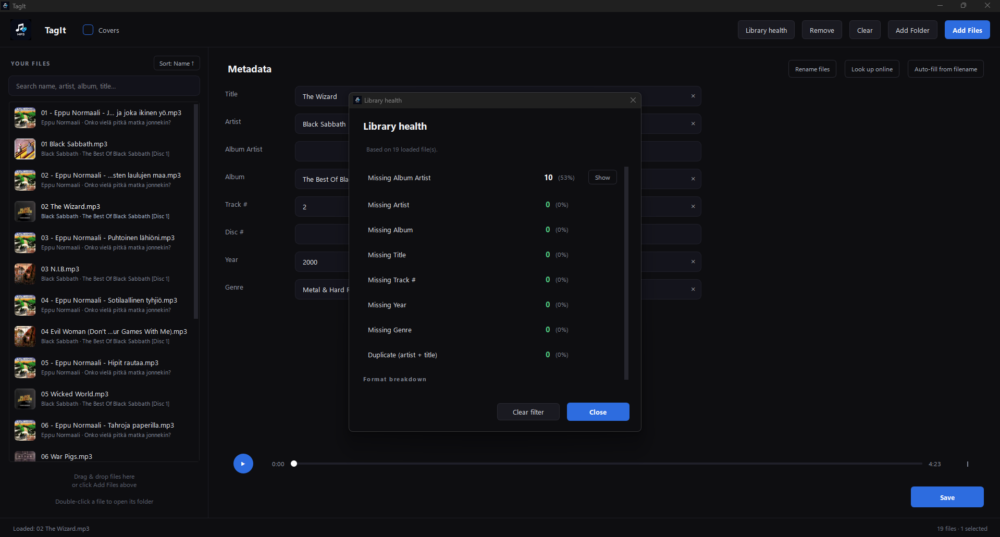
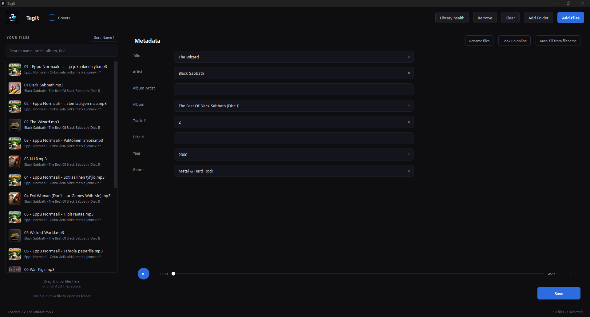

# TagIt

A lightweight tag editor for local music libraries. Built for people who
self-host their music (Navidrome, Jellyfin, Plex, Lyrion) and want their
metadata to be *correct* — without learning beets, fighting with Picard,
or opening a Swiss-Army-knife tool.





## What it does

- **Load files or folders** — drag & drop, "Add Files", "Add Folder" (recursive),
  or multiple selection
- **Edit tags** — Title, Artist, Album Artist, Album, Track #, Disc #, Year, Genre
- **Batch edit** — select multiple files, fill only the fields you want to change,
  optionally auto-number tracks
- **Auto-fill from filename** — guess tags from names like
  `01 - Artist - Title.mp3`
- **MusicBrainz lookup** — search online, pick the right release, and get
  accurate tags filled in. Only fills empty fields, never overwrites what you typed
- **Library Health** — a dashboard showing how many of your files are missing
  Album Artist, Artist, Album, Title, Track #, Year, or Genre, with clickable
  filters to fix them in bulk
- **Rename files on disk** — pattern-based renaming with a live preview and
  optional move-into-subfolders (e.g. `Artist/Album/01 - Title.mp3`)
- **Album cover thumbnails** — quiet background fetching from the Cover Art
  Archive, disk-cached, toggleable
- **Audio playback** — play/pause/seek the currently selected file
- **Undo** — Ctrl+Z restores the previous tags after a save or batch apply
- **Sort + search** — filter the list by name, artist, album, or title

## Download

**Windows installer:** [Latest release](https://github.com/tsiopoulostomas1-del/TagIt/releases/latest)

> The installer isn't code-signed, so Windows may show a SmartScreen warning
> the first time you run it. Click **More info** → **Run anyway**. This is
> expected for an unsigned open-source project and doesn't indicate any
> problem with the file.

**From source:** see [Install](#install) below.

## Supported formats

Reading and writing:
`.mp3`, `.flac`, `.m4a`, `.mp4`, `.ogg`, `.oga`, `.opus`, `.wav`, `.aiff`,
`.aif`, `.dsf`, `.wv`

Read-only (mutagen can read but not safely write):
`.wma`

## Install

Requires **Python 3.10+**.

```bash
git clone https://github.com/tsiopoulostomas1-del/TagIt.git
cd TagIt
python -m venv .venv
# Windows:
.venv\Scripts\activate
# macOS / Linux:
# source .venv/bin/activate
pip install -r requirements.txt
python main.py
```

## Keyboard shortcuts

| Shortcut | Action |
|---|---|
| `Ctrl+O` | Add files |
| `Ctrl+S` | Save (or Apply to selection if multiple files are selected) |
| `Ctrl+Z` | Undo last save / batch apply |
| `Ctrl+A` | Select all visible files |
| `Ctrl+F` | Focus the search box |
| `Ctrl+T` | Auto-fill from filename |
| `Ctrl+M` | Look up online (MusicBrainz) |
| `Ctrl+H` | Library health |
| `Ctrl+R` | Rename files |
| `Space` | Play / pause (when nothing is being typed) |
| `Delete` | Remove selected files from the list |
| `Esc` | Clear search → clear filter → clear selection |

## Why another tag editor?

Existing tools fall into two camps:

- **Simple taggers** (mp3tag and friends) — edit fields, that's it
- **Heavyweight library managers** (beets, Picard) — powerful but slow to learn

TagIt is for the middle: an app that gets out of the way and does one thing
well — clean up metadata before your local music server sees it.

## Built with

- [PySide6](https://pypi.org/project/PySide6/) — Qt 6 bindings for Python
- [mutagen](https://mutagen.readthedocs.io/) — audio metadata
- [musicbrainzngs](https://python-musicbrainzngs.readthedocs.io/) — MusicBrainz API
- [Cover Art Archive](https://coverartarchive.org/) — album cover images

## License

MIT — see [LICENSE](LICENSE).